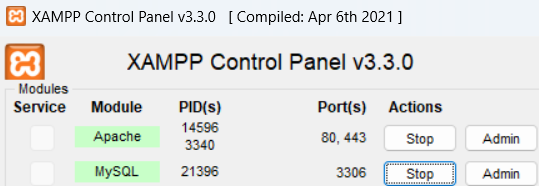

# ChatBot

## Start the app

This version to deploy the app is only dedicated to this branch. In this branch, we don't use Docker. We also don't use Kubernetes with minikube.

The app is composed of three components :
- the frontend - the chat interface (React)
- the backend - the server (Python)
- the sql database - the database (MySQL - XAMPP)

### Frontend

The frontend needs **nodeJS** to run. Download it on your own.

In a terminal, use the following commands to start the frontend :
- Go to the frontend folder
    ```bash
    cd .\frontend\
    ```
- Install the dependencies
    ```bash
    npm i
    ```
- Start the frontend
    ```bash
    npm start
    ```

### Backend

The backend needs **python 3.12.** to run. Download it on your own. \
To make clean project, we will use a virtual environment. 

In **another** terminal, use the following commands to start the backend :
- Go to the backend folder
    ```bash
    cd .\backend\
    ```
- Create a virtual environment
    ```bash
    python -m venv .venv
    ```
- Activate the virtual environment
    ```bash
    .venv\Scripts\activate
    ```
- Install the dependencies
    ```bash
    pip install -r requirements.txt
    ```
- Start the backend
    ```bash
    python app.py
    ```

### SQL Database

This part is a bit more complicated.
The sql database needs **XAMPP** to run. You can use another software if you want like **UWAMP**, **WAMP** or **MAMP**.

#### Step 1
Start the Apache and MySQL services. \
Be careful to ports. The Apache service is running on port **80** and the MySQL service is running on port **3306**.



#### Step 2

Create a new database named **chatbot_db**.


#### Step 3

Copy the content of the file **database/chatbot_db.sql** and paste it in the SQL tab.


#### Step 4

Depending on what you use, you may need to change the port of the database in the backend. \
The python backend is adapted to the port **3306** with **XAMPP** comfiguration located in the file **backend/app.py**.

```python
db = mysql.connector.connect(
    host="localhost",
    user="root",
    password="",
    database="chatbot_db",
    port=3306
)
``` 

```python
if __name__ == '__main__':
    app.run(port=8081, debug=True)
```

### Your APP is running !!!

In the frontend terminal, you can see the port of the frontend. \
It may be automatically opened in your browser.


## Execution


## Tutorial (stuff learned)

Tutorial to create the login - signup page :

https://www.youtube.com/watch?v=8QgQKRcAUvM

Tutorial to create the chat interface and authentification :

https://www.youtube.com/watch?v=k4mjF4sPITE

Create components :
    
```bash
rafce
```

add div :
        
```bash
div.my-class
```

Tutorial to connect the react app to the sql database :

https://www.youtube.com/watch?v=F53MPHqOmYI

```bash
npm init -y
```

```bash
npm install express mysql cors nodemon
```