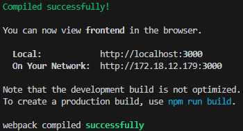
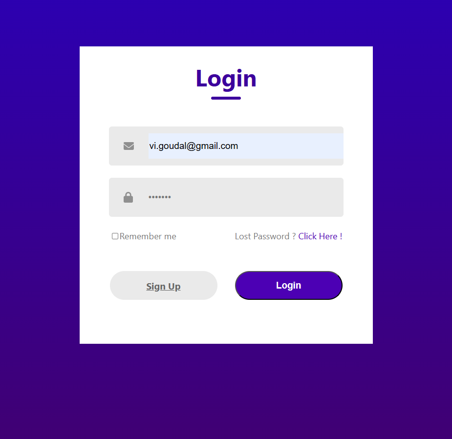
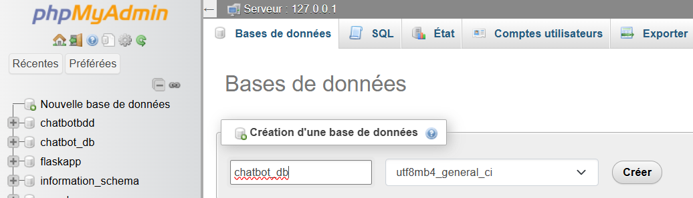
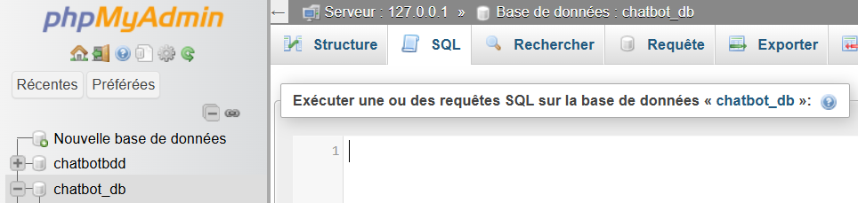

# ChatBot

## React App

### Start the app

```bash
cd .\react-app\
npm start
cd ..
```

### Execute the app






### Tutorial

Tutorial to create the login - signup page :

https://www.youtube.com/watch?v=8QgQKRcAUvM

Tutorial to create the chat interface and authentification :

https://www.youtube.com/watch?v=k4mjF4sPITE

Create components :
    
```bash
rafc
```

add div :
        
```bash
div.my-class
```

## sql-db with nodeJS

### Start the server

Use the following command to start the server :

```bash
cd .\sql-db\
npm start
```

### Tutorial

Tutorial to connect the react app to the sql database :

https://www.youtube.com/watch?v=F53MPHqOmYI

```bash
npm init -y
```

```bash
npm install express mysql cors nodemon
```
### Information about the server

The server is running on port **8081**.

The database is named **chatbot_db**.

The tables are :
- **users** : id, username, email, password

### Execute the server

